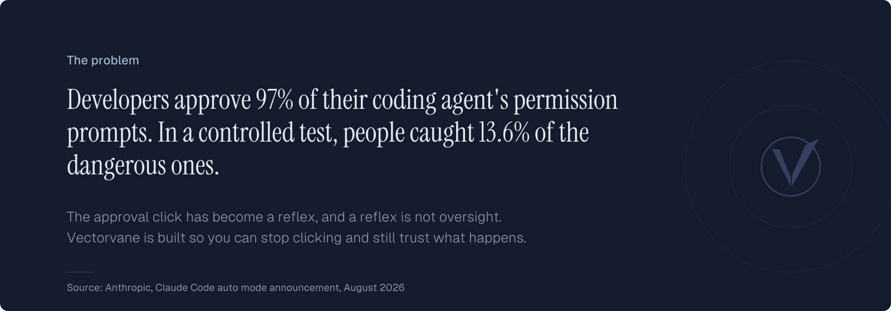
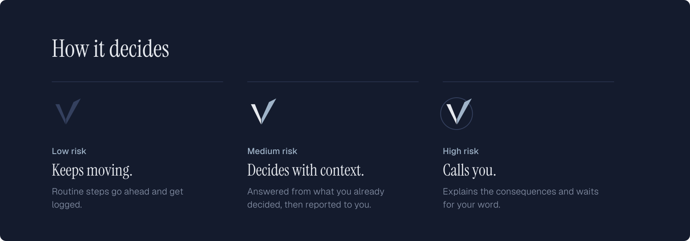
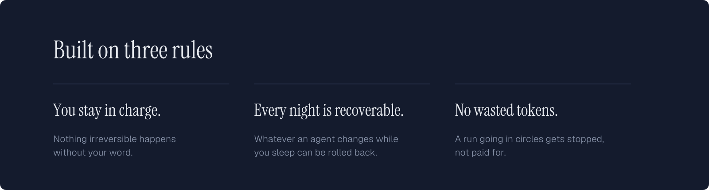
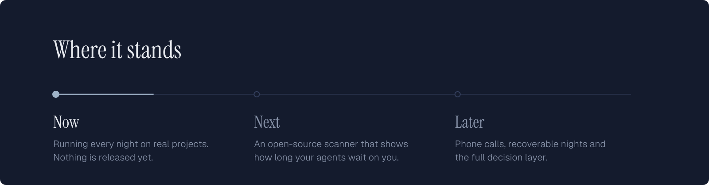
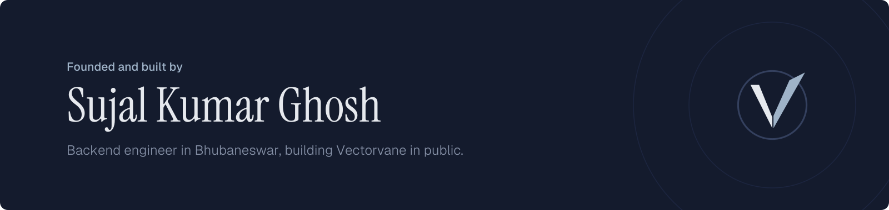

<picture>
  <source media="(prefers-color-scheme: dark)" srcset="./assets/hero-dark.svg">
  <source media="(prefers-color-scheme: light)" srcset="./assets/hero-light.svg">
  
</picture>

<picture>
  <source media="(prefers-color-scheme: dark)" srcset="./assets/problem-dark.svg">
  <source media="(prefers-color-scheme: light)" srcset="./assets/problem-light.svg">
  
</picture>

<picture>
  <source media="(prefers-color-scheme: dark)" srcset="./assets/night-dark.svg">
  <source media="(prefers-color-scheme: light)" srcset="./assets/night-light.svg">
  
</picture>

<picture>
  <source media="(prefers-color-scheme: dark)" srcset="./assets/tiers-dark.svg">
  <source media="(prefers-color-scheme: light)" srcset="./assets/tiers-light.svg">
  
</picture>

<picture>
  <source media="(prefers-color-scheme: dark)" srcset="./assets/rules-dark.svg">
  <source media="(prefers-color-scheme: light)" srcset="./assets/rules-light.svg">
  
</picture>

<picture>
  <source media="(prefers-color-scheme: dark)" srcset="./assets/status-dark.svg">
  <source media="(prefers-color-scheme: light)" srcset="./assets/status-light.svg">
  
</picture>

<picture>
  <source media="(prefers-color-scheme: dark)" srcset="./assets/founder-dark.svg">
  <source media="(prefers-color-scheme: light)" srcset="./assets/founder-light.svg">
  
</picture>

  Follow the build on <a href="https://www.linkedin.com/in/sujalkrghosh">LinkedIn</a> and <a href="https://x.com/sujalkrg">X</a>, or see Sujal's open-source work on <a href="https://github.com/SujalKrG">GitHub</a>, including <a href="https://github.com/SujalKrG/offscript">offscript</a>.

<picture>
  <source media="(prefers-color-scheme: dark)" srcset="./assets/footer-dark.svg">
  <source media="(prefers-color-scheme: light)" srcset="./assets/footer-light.svg">
  
</picture>
